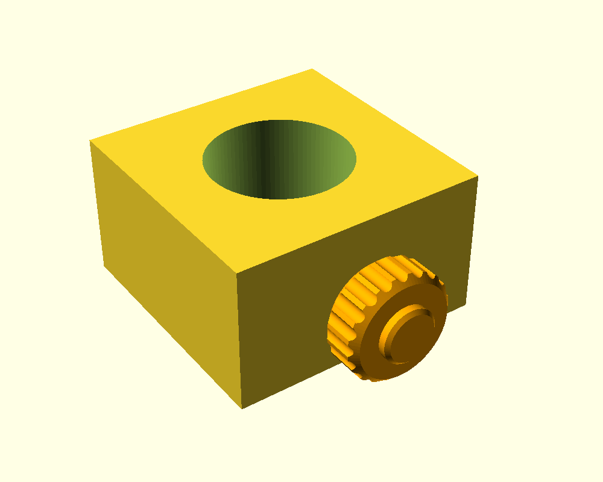

# OpenSCAD_dowel_trim_jig

Jig for sawing 38.1 mm (1.5 in) round dowel square. A block with a bore the dowel slides through. The saw blade rests flat on the top face and is held in place by magnets embedded under the surface. A threaded clamp bolt with a knurled knob locks the dowel while cutting.

## Parts

| File | Part |
|------|------|
| `dowel_jig_simple.stl` | Block with bore, magnet pockets and threaded clamp hole |
| `dowel_bolt.stl` | M8x1.25 clamp bolt with knurled knob |
| `dowel_jig_simple.scad` | Parametric source. Set `part` to `jig`, `bolt` or `assembly` |

## Key dimensions

- Block 70 x 70 x 40 mm, bore 38.5 mm (38.1 mm dowel + 0.4 mm clearance)
- 8 magnet pockets for 10 x 3 mm discs (4 at the sides, 4 at the corners), 0.8 mm solid roof over each
- M8x1.25 clamp hole through the -X wall, halfway up

## Printing

1. Print the jig with the top face up.
2. Pause before layer 197 (z = 39.4 mm at 0.2 mm layers, 0.2 mm first layer). The OpenSCAD console echoes the numbers and they update if you change layer height or magnet size.
3. Insert magnets in the pockets you want, all with the same face up, then resume. Empty pockets are printed over.
4. Print the bolt flipped, with the flat top of the knob on the bed and the thread pointing up.

## Dependencies

OpenSCAD libraries on the library path:

- [BOSL2](https://github.com/BelfrySCAD/BOSL2) for threads
- [parametric-knob-maker](https://github.com/morganp/parametric-knob-maker) for the knob

## Status

Not yet test printed. Thread slop (0.2 mm), bore clearance (0.4 mm) and magnet hold through the 0.8 mm roof are untested.
